# Arbiter

I got tired of playing Path of Exile 2 with twenty trade tabs, a mod site, a regex generator, and a rough guess of whether my farming strat was even making money. So I built Arbiter.

Arbiter puts the PoE 2 economy in one local desktop app, all running off the same live exchange rates. You can organize real trade searches into folders, snipe live pings from one hotkey, and reprice listings into whichever currency is actually cheapest. It tracks your stash, Ange merchant shop listings, and farming div/hr, finds Currency Exchange arbitrage after gold fees, and ranks which currencies hold value against league inflation. When you're rolling maps or gear, it handles waystone regexes and crafting mod odds with live essence prices too.

**[Download for Windows (x64) and macOS (Apple Silicon)](https://github.com/Shazambom/shazam-poe2-dashboard/releases/latest)**

Install it, log in once from the top bar with your Path of Exile or Steam account (optional if you only use Board, Mods, Regex, or Convert), and you're in. Everything runs locally on your machine. See [Security and privacy](SECURITY.md) and our [Code signing policy](CODE_SIGNING.md) for the full technical breakdown.

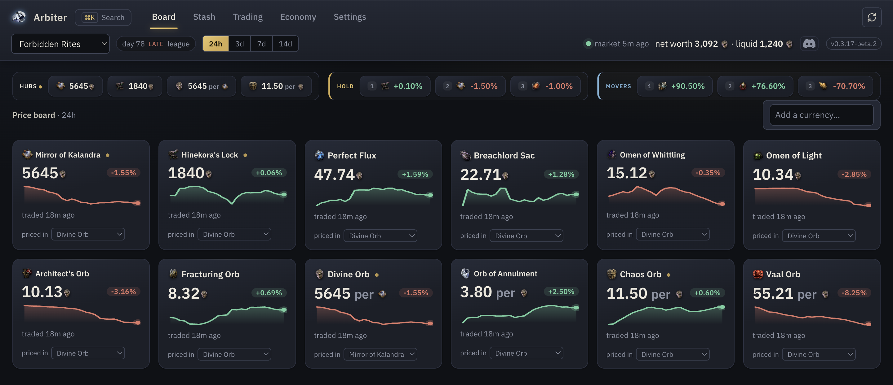

## Trading

The real `pathofexile.com/trade2` runs inside Arbiter, logged in, with drag-and-drop folders for sniping, mapping, crafting bases, and gear upgrades. Every search defaults to Instant Buyout so Travel to Hideout works on the first click.

Copy an item in game with `Ctrl+C` (or price-check it with Exiled Exchange 2) and it lands in your Exiled Exchange 2 history folder with a search ready to run. If a rare item search comes back empty because one roll is slightly too strict, click **Close-enough** to relax the modifiers and pull up the nearest real matches in one click. You can also watch up to 20 live searches at once. When something pings, hit `Ctrl+G` on Windows or `Cmd+G` on Mac to pull up the newest listing and travel straight to the seller's hideout without digging through browser tabs.

The trade site sorts "cheapest first" using its own exalted-equivalent rates, which can disagree with the live Currency Exchange. Overpriced listings often sit at the top while cheaper ones in another currency sit buried underneath. Arbiter checks the listings loaded on the page against live currency rates and lights up a gold **Reprice in [currency]** button whenever another currency beats it. Click it to re-run and save the search in the cheaper currency.

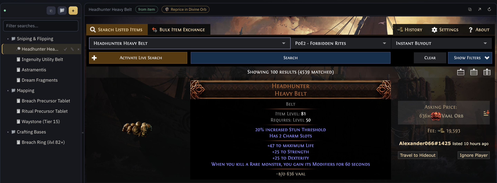
*Default sort puts a Headhunter at 636 Vaal Orbs, about 11.5 Divines, in the top slot. Arbiter spots the gap and offers **Reprice in Divine Orb**.*

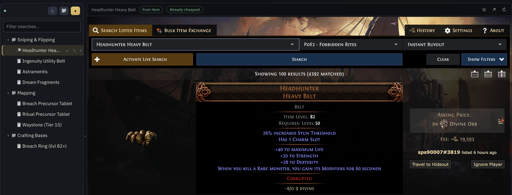
*After repricing, the pill turns green with **Already cheapest** and the top belt is 9 Divine Orbs. That's a 2.5 Divine gap between the two asks (always compare item rolls before buying).*

## Stash, Ange Merchant shop, and Strat Calculator

Stash groups your currencies by league mechanic and prices your bank in whatever currency you want. Toggle things like Hinekora's Lock off to separate long-term holds from liquid currency. Merchant sales sync automatically and credit your holdings without double-counting.

**Merchant** tracks your live Ange shop listings straight from the trade site, converts mixed currencies into one view, flags listings losing value to inflation while they sit in your shop, spots stale items ready for a price cut, and lets you build a quick stash search to reprice them in bulk.

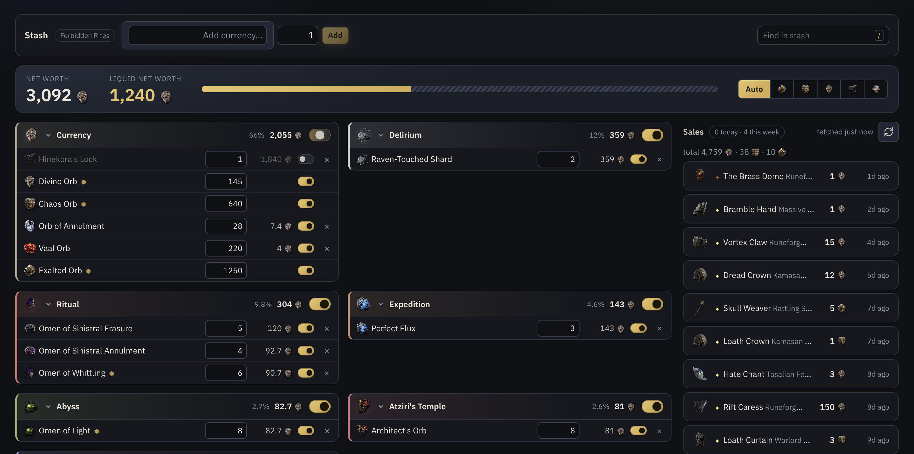

**Strat Calculator** tracks what your farming setups actually pay per hour instead of what they feel like they pay. Save named strats for mapping or bossing, pull live prices for waystones, tablets, and unique floors from your saved searches or market rates, let the auto-timer track your maps from `Client.txt` (pausing in town and hideout), and log drops as you go.

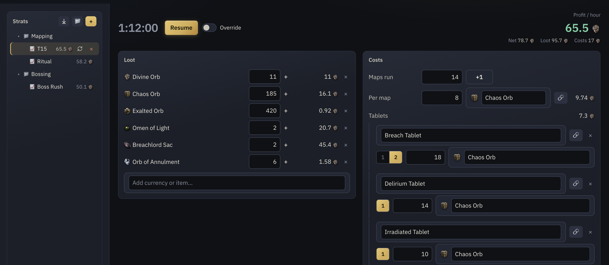

## Arbitrage and Convert

Tell Arbiter which currencies it can use from your stash and how much gold is worth to you. It simulates Currency Exchange loops, vendor recipes included, deducts the real gold fees, estimates how long each step takes to fill from actual hourly volume, and ranks loops by profit, yield grade, and fill time. I've been using it to make quite a bit of currency.

When you just need to swap one currency into another, **Convert** finds the cheapest multi-hop path so you don't lose currency to a bad direct spread or rounding.

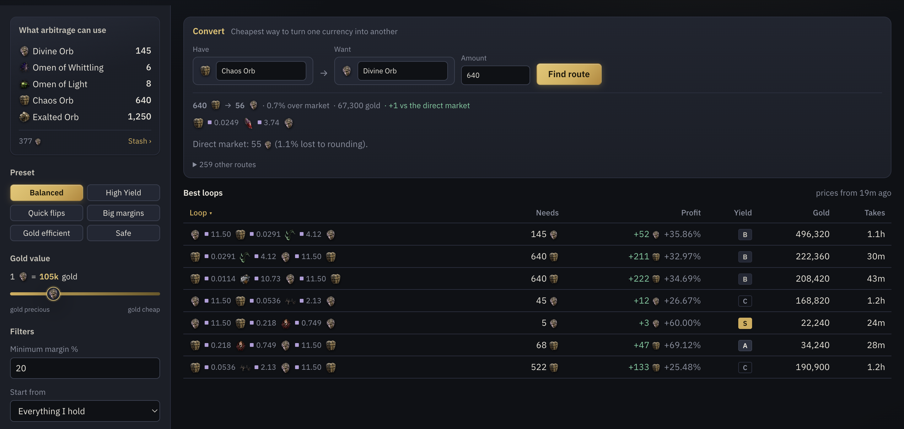

## Hold, inflation, and market volume

Soft currencies bleed value fast over a league. **Hold** scores every currency as a store of value against a hard anchor like Divine Orb or Hinekora's Lock, so you know where to park your currency before logging off.

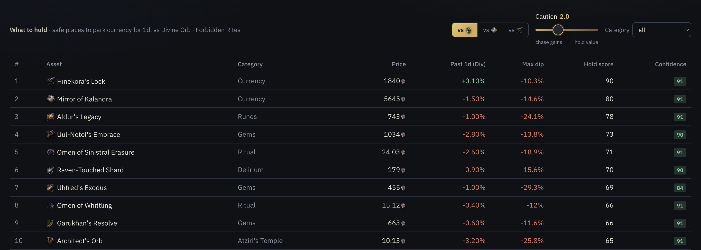

**Inflation** plots currency drift against your chosen anchor, alongside cross-league comparisons and daily economy size. **Market** shows pair history, hourly volume bars, and the busiest pairs over the last 24 hours. Click any card on the **Board** to open its full history and every active pair.

| | |
|---|---|
| 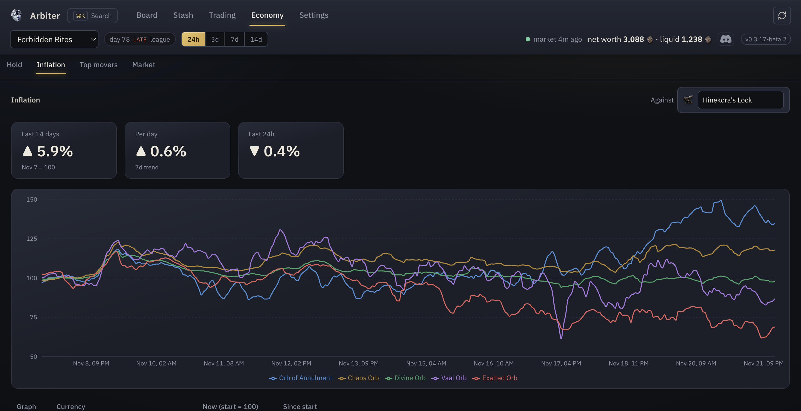 | 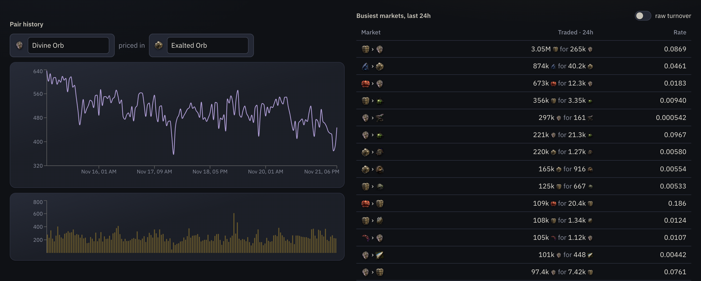 |
| **Inflation.** How fast soft currencies are slipping against a hard anchor. | **Market.** Pair history, hourly volume, and where the last 24h of trading actually happened. |

## Mods and Regex

**Mods** lists every prefix, suffix, corrupted implicit, essence, alloy, and socketable pool that can roll on a base at your item level, with real weights. Press `Ctrl+V` with an item copied from PoE 2 to cross off the mod families already on it, recalculate what can still hit, and see what forcing a mod costs at live essence and omen prices.

**Regex** writes waystone and tablet stash search strings for tier, rarity, revives, mods you want, and mods you want to skip, all inside the 250-character stash box limit. If you'd rather buy rolled maps than roll them yourself, **Search on trade** sends that same filter straight to the trade site.

| | |
|---|---|
| 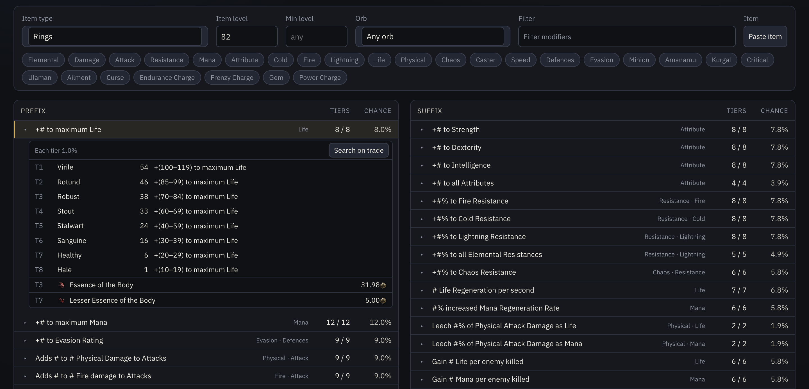 | 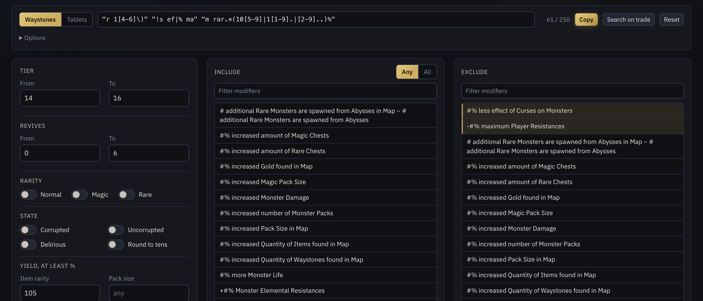 |
| **Mods.** Real weights, `Ctrl+V` item odds, and what forcing a mod costs. | **Regex.** Stash search strings that also open straight on trade. |

## Themes

Pick from six built-in themes, or open **Custom themes** in Settings to tweak the palette yourself.

| Vault | Arbiter of Ash | Arbiter of Divinity |
|---|---|---|
|  | 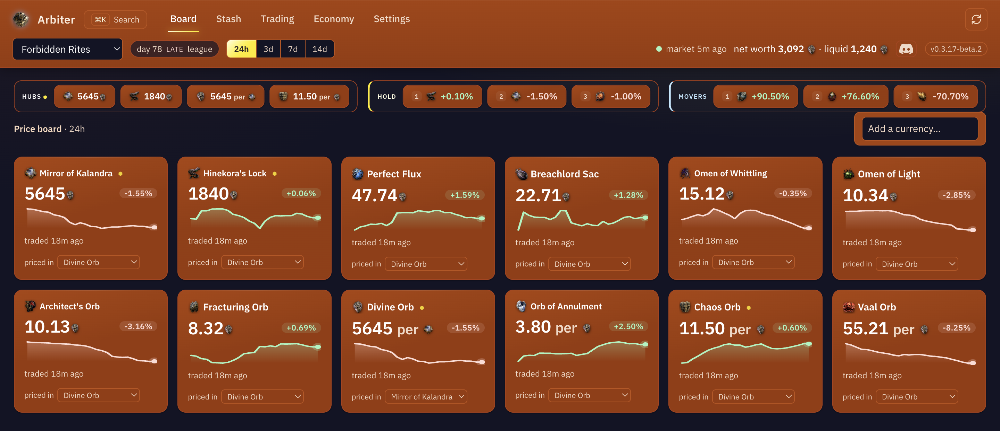 | 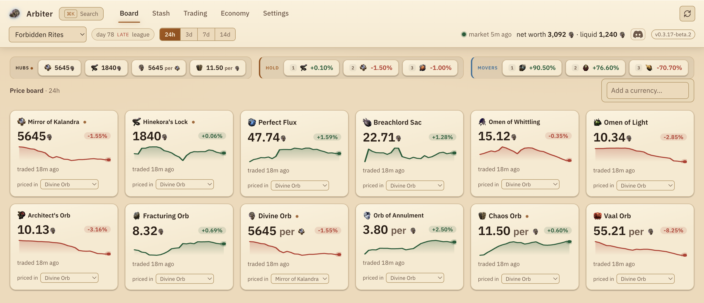 |

| Trial of the Sekhemas | Vaal | Azmeri |
|---|---|---|
| 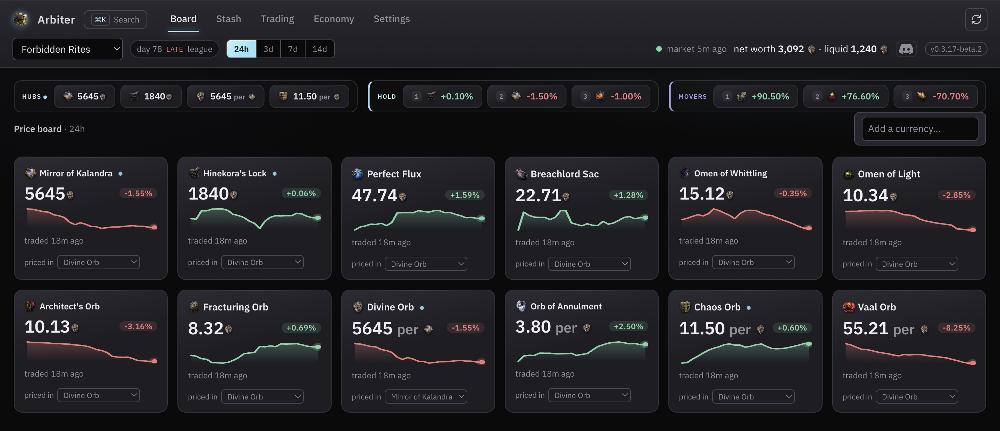 | 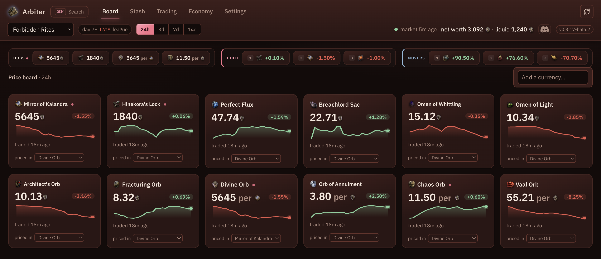 | 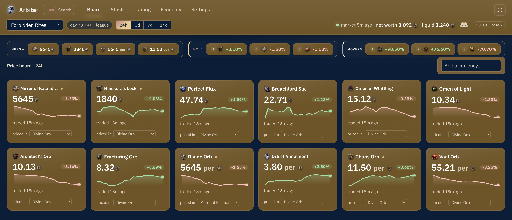 |

## Get it

Download the latest **[Windows installer / portable ZIP or macOS Apple Silicon DMG](https://github.com/Shazambom/shazam-poe2-dashboard/releases/latest)**. Open Arbiter, click **Connect** in the top bar if you want to log in with your Path of Exile or Steam account for Trade and Merchant features, and you're good to go. Windows builds update themselves from GitHub Releases; macOS builds prompt you to grab the new DMG.

- **Platforms:** Windows x64 (`Arbiter-Setup-<ver>.exe` or portable `Arbiter-<ver>-win.zip`) and macOS Apple Silicon (`arm64` DMG). Downloads are around 200 MB because Arbiter bundles its local database engine and market snapshot so nothing needs an external server.
- **First-run OS warnings:** Until code signing via SignPath Foundation is active, Windows SmartScreen will show an "Unknown publisher" warning (**More info -> Run anyway**) and macOS Gatekeeper may require **System Settings -> Privacy & Security -> Open Anyway**. Every Windows release is built publicly in GitHub Actions with verifiable provenance and SHA-256 hashes. See [CODE_SIGNING.md](CODE_SIGNING.md).
- **Privacy & security:** Everything runs locally on your machine with no Arbiter account, no remote Arbiter server, and zero telemetry in stable builds. Arbiter talks only to Path of Exile (`pathofexile.com`, `web.poecdn.com`), community economy/game data sources (`api.poe2scout.com`, `poe2db.tw`, RePoE), and GitHub Releases for updates. Full breakdown in [SECURITY.md](SECURITY.md).
- **Uninstall:** Standard OS uninstall removes the app; local data lives in `%APPDATA%\Arbiter` (Windows) or `~/Library/Application Support/Arbiter` (macOS).
- **Questions or bugs:** Open a [GitHub Issue](https://github.com/Shazambom/shazam-poe2-dashboard/issues) or join the [Discord](https://discord.gg/xxEDMkfqJg).

## Credits and disclaimer

Arbiter is licensed under the [MIT License](LICENSE). Trading folders took inspiration from **Better Trading**, item-search query parsing vendors **Exiled Exchange 2** (MIT, see [`desktop/src/vendor/ee2-query/`](desktop/src/vendor/ee2-query/)), and economy/mod data builds on GGG's public hourly Currency Exchange digest, **poe2scout**, **poe2db**, and **RePoE**.

*Arbiter is an independent fan-made project and is not affiliated with or endorsed by Grinding Gear Games.*
